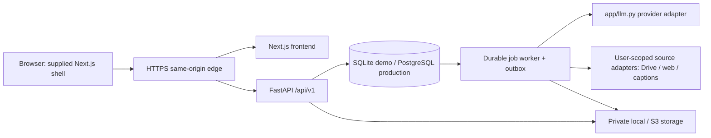

# Architecture and implementation layout



Browser calls `/api/v1/*` on the same origin. FastAPI routes include `/api/v1`; the reverse proxy forwards that prefix unchanged. In development, a Next.js rewrite forwards only `/api/v1/:path*` to `http://127.0.0.1:8000/api/v1/:path*`; in production, the edge routes `/api/v1/*` directly to the backend. No client secret or runtime assumption about an inaccessible cloud loopback preview. Browser screenshots/local requests are internal verification.

## Intended generated tree

```
AGENTS.md
frontend/               # copied from reference/dashboard; its lockfile/agent rules preserved
  src/app/              # shared AppShell layouts and specified routes
  src/components/       # original components adapted; Study/Outline/Upload additions
  src/lib/api.ts        # typed same-origin client and serializable view models
  tests/                # component tests
  e2e/                  # Playwright functional/visual/accessibility tests
backend/
  pyproject.toml, uv.lock
  app/main.py, settings.py, models.py, schemas.py, auth.py
  app/llm.py            # only external model-call implementation
  app/ingest.py, review.py, sessions.py, citations.py
  app/providers/        # model provider boundary, structured outputs, fake provider
  app/sources/          # local, Drive/MCP, public page, captions adapters
  app/jobs.py, worker.py, storage.py, events.py
  app/prompts/          # runtime Planner, Quizzer, Reviewer; shared contract, not developer TOML
  migrations/           # Alembic SQLite/Postgres-compatible revisions
  tests/                # unit, contract, integration, concurrency, tenant tests
scripts/                # setup/dev/check, daily_review.py, seed/reset demo, release/restore checks
deploy/                 # Dockerfiles, compose demo and production, HTTPS edge, env templates
.github/workflows/      # CI on PR; deployment separate from untrusted PR execution
contracts/, docs/, fixtures/, reference/, .codex/, .agents/skills/
```

## Execution modes

`APP_MODE=demo`: single synthetic local learner, SQLite, local private blobs, deterministic fake provider, banner. Can start without external keys. `APP_MODE=live`: authenticated or explicitly restricted local learner, real AI, user-scoped connectors; no automatic fake results on errors. `APP_MODE=production`: OIDC, secure sessions, PostgreSQL, private object store and production worker mandatory; fail startup if demo identity/fake provider, unsafe origins, missing secrets or SQLite is configured.

Develop an adapter contract and run the same suite against fake and real providers where credentials permit. Default live model is selected from a currently supported, structured-output/vision-capable model after a successful discovery/smoke call; record exact ID, provider, schema version, prompt version, usage and latency. Do not hardcode an unverified model name in this package.

## Background work without early extra infrastructure

Durable jobs in the database: type, owner/collection, payload reference, idempotency key, attempts, next-run instant, lease, status and error code. Production claim uses row locks with `FOR UPDATE SKIP LOCKED`, lease renewal, bounded retries/backoff, terminal failure, and recovery after worker death. SQLite demo uses one worker and serialized claims. An outbox event written in the same transaction as an answer/finish ensures Reviewer summary and next-review work survive process restart. Worker actions are idempotent. SQL transaction never remains open while calling a model/network provider.

Start with one API and one worker; scale API and worker separately on PostgreSQL. No runtime subprocess invocation of privileged Codex tools with learner prompts. Developer sessions use Codex in its sandbox; runtime model tools get narrow source access and no repository shell. A supported Codex SDK experiment is separate, sandboxed, and clearly labeled until equivalent runtime isolation, auth and reliability are proven.

## Data boundaries

OIDC login lives server-side (FastAPI auth routes); signed opaque session cookie is HttpOnly/Secure/SameSite=Lax on one origin. CSRF token for cookie-authenticated mutations. Next server-side fetch forwards only the session credential to a configured internal backend and never caches another learner's response. A trusted backend resolves learner ownership; never trust arbitrary `user_id` headers.

Private uploads/object keys are tenant-scoped; citation reads authorize ownership and serve short-lived signed URLs or authenticated streaming. AI requests receive only required cited excerpts. No source content in CI logs, browser error traces or Git evidence. Provider OAuth tokens remain encrypted server-side and are not re-used from a developer connector without an explicit supported runtime boundary.

Runtime role contracts: docs/runtime-agents/PLANNER.md, QUIZZER.md and REVIEWER.md. Copy/version these into backend/app/prompts when implementing, with tested structured/public-private boundaries.

## Revision 2 paths

Frontend catalogs/preference store drive multilingual rendering; backend session roles receive study language with original cited excerpts. Browser speech discovers real voices; server STT/TTS adapter through app/llm.py supplies missing supported-language path. Same-origin speech endpoints enforce session/privacy/rate limits. New generated frontend files include locale catalogs/registry, language chooser and logical RTL styles; backend source/speech tests cover all target locales.

Drive durable worker stages: reconcile app root → reconcile Collection folder → write original/link snapshot → bind confirmed remote identity → common extract → verify citations. Polling receives manually dropped or app-created files and reconciles the same identity/revision rather than running a second independent ingest path. Private app storage remains staging/cache; connected success means confirmed Drive placement. Exact contracts are INTERNATIONALIZATION and DRIVE_INGESTION. Runtime source adapters now need scoped writes as well as read, even when developer MCP proof uses a read-only probe.

## Source chunk preparation update (2026-10-14)

`source-excerpts-v2` remains immutable for existing revisions. New `source-excerpts-v3` uses structure-aware PDF/Markdown/TXT/DOCX/RST/CSV/TSV/XLSX/JSON/YAML/log extraction and OpenAI `tiktoken`: sentence-aware 160-token teaching windows with 20-token context overlap. Actual source sections remain learner-selected titles; concepts/windows underneath them do not change scope denominators. Page, heading, line, row, sheet, cell and JSON/YAML key-path locators resolve against exact extracted source excerpts. HTML uploads remain excluded, and scanned-PDF OCR is bounded and uses only the server vision boundary. Original bytes remain privately retained and citations download the original. Reprocessing is a new immutable revision and requires an explicit scope update; no existing citation, scope, assessment or history is rewritten.

## Migration-aware readiness

`GET /api/v1/ready` compares the complete set of database Alembic revisions with the complete set of heads in the migration files shipped with this backend. A fixed migration ID must never define readiness: adding a migration changes the expected graph automatically. Behind, unknown or incomplete head sets return database `migration-required`; unavailable database/schema returns `unavailable`. Worker freshness, model mode and required authentication checks remain separate. Startup verifies readiness through the frontend same-origin rewrite as well as directly against the backend.
